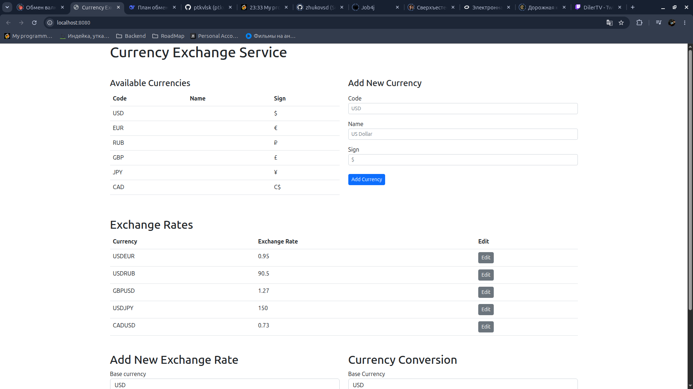

# Currency Exchange API

> REST API для работы с валютами и обменными курсами. Позволяет просматривать, создавать и редактировать валюты и курсы, а также конвертировать произвольные суммы из одной валюты в другую.
>
> REST API for currencies and exchange rates. Supports viewing, creating, and editing currencies and rates, as well as converting arbitrary amounts between currencies.

[](https://openjdk.org/projects/jdk/17/)
[](https://jakarta.ee/specifications/servlet/6.0/)
[](https://www.sqlite.org/)
[](https://tomcat.apache.org/)
[](#-тестирование--testing)
[](#-лицензия--license)

---

## 🌐 Live Demo

**🔗 [https://ptkvlsk.ru/](https://ptkvlsk.ru/)**

Развёрнуто на VPS (Ubuntu 24.04): Tomcat 10 слушает только localhost, перед ним Nginx (reverse proxy) с HTTPS-сертификатом Let's Encrypt.

Deployed on a VPS (Ubuntu 24.04): Tomcat 10 listens on localhost only, with Nginx (reverse proxy) and a Let's Encrypt HTTPS certificate in front of it.

---

## 🛠 Стек технологий / Tech Stack

| Компонент | Технология |
|-----------|------------|
| **Язык / Language** | Java 17 |
| **Web / HTTP** | Jakarta Servlet API 6.0 (без фреймворков) |
| **База данных / Database** | SQLite + JDBC, пул соединений HikariCP / connection pool |
| **JSON** | Jackson Databind |
| **Логирование / Logging** | SLF4J + Logback |
| **Сборка / Build** | Maven (WAR) |
| **Сервер / Server** | Apache Tomcat 10.1 |
| **Reverse Proxy** | Nginx |

---

## ✨ Функционал / Features

**Валюты / Currencies**
- Просмотр списка валют и отдельных валют по коду · List all currencies and get a single currency by code
- Добавление новых валют · Add new currencies

**Курсы / Exchange Rates**
- Просмотр списка обменных курсов и курсов по валютной паре · List all exchange rates and get a rate by currency pair
- Создание и обновление обменных курсов · Create and update exchange rates

**Конвертация / Conversion**
- Перевод суммы из одной валюты в другую по трём сценариям · Convert amounts between currencies using three scenarios:
    - прямой курс · direct rate
    - обратный курс · reverse rate
    - кросс-курс через USD · cross-rate via USD

---

## 🏗 Архитектура / Architecture

```
Клиент → Фильтры → Servlet → Service → DAO → SQLite
Client → Filters → Servlet → Service → DAO → SQLite
```

- **Servlet** — только HTTP: достаёт параметры, валидирует их, вызывает сервис, отправляет ответ · HTTP only: reads and validates parameters, calls a service, sends the response
- **Service** — бизнес-логика, в том числе конвертация валют (прямой, обратный и кросс-курс) · business logic, including currency conversion
- **DAO** — SQL-запросы; сервисы зависят от интерфейсов, а не от JDBC-классов · SQL queries; services depend on interfaces, not on JDBC classes
- **ExceptionHandlingFilter** — единая точка обработки ошибок: тип исключения превращается в HTTP-код и JSON · the single place that maps exceptions to HTTP codes and JSON
- **AppContextListener** — при старте инициализирует БД, создаёт DAO и сервисы и кладёт сервисы в `ServletContext`; при остановке закрывает пул соединений · initializes the DB at startup, creates DAOs and services and publishes services to the `ServletContext`; closes the connection pool on shutdown

---

## 📡 API Endpoints

| Method | URL | Description |
|--------|-----|-------------|
| `GET` | `/currencies` | Список всех валют / All currencies |
| `GET` | `/currency/{code}` | Одна валюта / Single currency |
| `POST` | `/currencies` | Создать валюту / Create currency |
| `GET` | `/exchangeRates` | Список всех курсов / All exchange rates |
| `GET` | `/exchangeRate/{pair}` | Один курс / Single rate (e.g. `USDEUR`) |
| `POST` | `/exchangeRates` | Создать курс / Create rate |
| `PATCH` | `/exchangeRate/{pair}` | Обновить курс / Update rate |
| `GET` | `/exchange?from=X&to=Y&amount=Z` | Конвертация / Convert |
| `GET` | `/health` | Проверка доступности / Health check |

**Формат ошибок / Error format:**
```json
{ "message": "Валюта с кодом XXX не найдена" }
```

**HTTP-коды:** `200`, `201`, `400`, `404`, `409`, `500`

### Пример / Example

```bash
# Список валют
curl https://ptkvlsk.ru/currencies

# Конвертация
curl "https://ptkvlsk.ru/exchange?from=USD&to=RUB&amount=100"
```

```json
{
    "baseCurrency": { "id": 1, "name": "United States dollar", "code": "USD", "sign": "$" },
    "targetCurrency": { "id": 3, "name": "Russian Ruble", "code": "RUB", "sign": "₽" },
    "rate": 90.5,
    "amount": 100,
    "convertedAmount": 9050.00
}
```

---

## 🔎 Валидация входных данных / Input Validation

| Поле / Field | Правило / Rule |
|--------------|----------------|
| Код валюты (`code`, `baseCurrencyCode`, `targetCurrencyCode`, `from`, `to`, пара в URL) | Три латинские буквы, регистр не важен · Three Latin letters, case-insensitive |
| `name`, `sign` | Не пустые, пробелы по краям обрезаются; `sign` не длиннее 3 символов · Not blank, trimmed; `sign` up to 3 characters |
| `rate`, `amount` | Число больше нуля, не больше 1 000 000 000, не более 6 знаков после запятой · Number > 0, at most 1 000 000 000, at most 6 decimal places |
| Валютная пара при создании курса / Pair on create | Валюты должны различаться · Currencies must be different |

При нарушении правил API возвращает `400` с описанием проблемы.

On violation the API responds with `400` and a description of the problem.

---

## ✅ Тестирование / Testing

API прошёл **автоматическое тестирование** ботом — **98/98 кейсов пройдено**:

- ✅ Все CRUD-операции для валют и курсов
- ✅ Все три сценария конвертации (прямой, обратный, кросс-курс через USD)
- ✅ Валидация входных данных (пустые поля, некорректные значения, формат кодов, положительные значения, границы)
- ✅ Валюты в паре должны различаться
- ✅ Обработка ошибок (400, 404, 409)
- ✅ Корректная структура JSON-ответов
- ✅ Правильные HTTP-коды и `Content-Type`

---

## 📂 Структура проекта / Project Structure

```
src/main/java/com/boo4er/currencyexchange/
├── config/       — AppContextListener: старт БД, сборка зависимостей / startup and wiring
├── dao/          — интерфейсы и JDBC-реализации / DAO interfaces and JDBC implementations
├── dto/          — ответы API (record) / response records
├── exception/    — исключения без привязки к HTTP / HTTP-agnostic exceptions
├── filter/       — ExceptionHandlingFilter, PatchFilter
├── mapper/       — модель → DTO / model → DTO
├── model/        — неизменяемые модели / immutable domain models
├── service/      — бизнес-логика, конвертация / business logic, conversion
├── servlet/      — тонкие REST-контроллеры / thin servlets
├── util/         — утилиты / utilities
└── validation/   — проверка и нормализация входных данных / input validation

src/main/resources/
├── db/init.sql       — схема и начальные данные / schema and seed data
├── db.properties     — настройки БД / database settings
└── logback.xml       — логирование / logging
```

---

## 🚀 Запуск локально / How to Run Locally

### Требования / Requirements

- Java 17+
- Maven 3.8+
- Apache Tomcat 10

### Шаги / Steps

**1. Клонировать / Clone**
```bash
git clone https://github.com/ptkvlsk/currency-exchange.git
cd currency-exchange
```

**2. Собрать WAR / Build WAR**
```bash
mvn clean package
```

**3. Развернуть в Tomcat / Deploy to Tomcat**

Скопируйте WAR в папку `webapps` вашего Tomcat:
Copy the WAR to your Tomcat's `webapps` folder:

```bash
cp target/currency-exchange.war $CATALINA_HOME/webapps/
```

Где `$CATALINA_HOME` — путь к установленному Tomcat (например, `/opt/tomcat`).
Where `$CATALINA_HOME` is the path to your Tomcat installation (e.g. `/opt/tomcat`).

Запустите Tomcat:
Start Tomcat:

```bash
$CATALINA_HOME/bin/startup.sh
```

**4. Открыть / Open**

При запуске через standalone Tomcat:
When running via standalone Tomcat:
```
http://localhost:8080/currency-exchange/
```

При запуске через IntelliJ IDEA (Smart Tomcat):
When running via IntelliJ IDEA (Smart Tomcat):
```
http://localhost:8080/
```

База данных SQLite создастся автоматически при первом запуске.
The SQLite database is created automatically on first launch.

---

## ⚙️ Конфигурация / Configuration

**Путь к базе данных / Database path**

По умолчанию задан в `src/main/resources/db.properties`:
Defined by default in `src/main/resources/db.properties`:

```properties
db.path=data/currency.db
```

Переменная окружения `DB_PATH` имеет приоритет над файлом:
The `DB_PATH` environment variable takes precedence over the file:

```bash
DB_PATH=/var/lib/currency-exchange/currency.db $CATALINA_HOME/bin/startup.sh
```

Относительный путь считается от рабочей директории процесса Tomcat, поэтому на сервере лучше указывать абсолютный.
A relative path is resolved from the Tomcat process working directory, so use an absolute path on a server.

**Логи / Logs**

Пишутся в консоль и в файл, настройки в `src/main/resources/logback.xml`.
Written to the console and to a file, see `src/main/resources/logback.xml`.

---

## 🖥 Деплой / Deployment

```
Клиент → Nginx (80/443, HTTPS) → Tomcat (127.0.0.1:8080) → SQLite
Client → Nginx (80/443, HTTPS) → Tomcat (127.0.0.1:8080) → SQLite
```

- WAR разворачивается как `ROOT.war`, поэтому приложение открывается в корне сайта · the WAR is deployed as `ROOT.war`, so the app is served from the site root
- Tomcat слушает только `127.0.0.1`, наружу открыты только порты Nginx · Tomcat listens on `127.0.0.1` only; only Nginx ports are exposed
- Путь к БД задаётся переменной `DB_PATH` (например, `/var/lib/currency-exchange/currency.db`) · the DB path is set via `DB_PATH`
- HTTPS-сертификат выпущен Let's Encrypt (certbot), продлевается автоматически · the HTTPS certificate is issued by Let's Encrypt (certbot) and renewed automatically

---

## 📸 Скриншоты / Screenshots



> **Note:** Для визуального тестирования API подключён тестовый фронтенд от [Сергея Жукова](https://github.com/zhukovsd/currency-exchange-frontend). Backend полностью написан мной.
>
> The test frontend from [Sergey Zhukov](https://github.com/zhukovsd/currency-exchange-frontend) is used for API visual testing. The backend is fully my own work.

---

## 👤 Автор / Author

**ptkvlsk** — [@ptkvlsk](https://github.com/ptkvlsk)

Учебный проект в рамках курса [«Java Backend Learning Course»](https://zhukovsd.github.io/java-backend-learning-course/) Сергея Жукова.
Educational project based on [Sergey Zhukov's Java Backend Learning Course](https://zhukovsd.github.io/java-backend-learning-course/).

---

## 📄 Лицензия / License

Учебный проект. Свободен для использования в образовательных целях.
Educational project. Free to use for educational purposes.